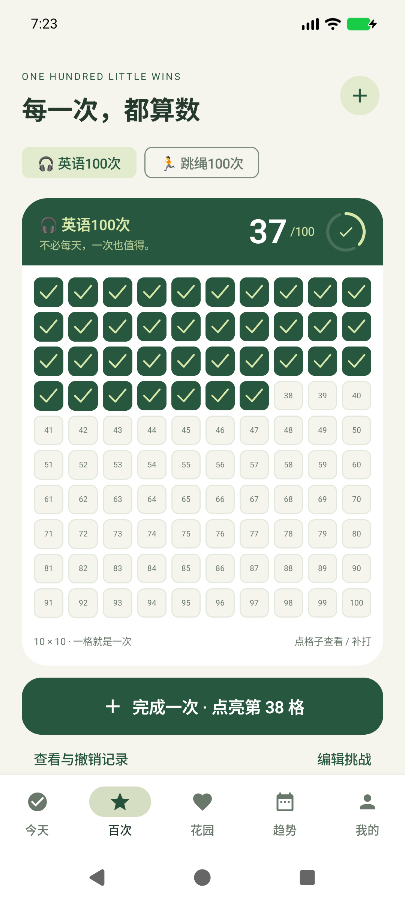
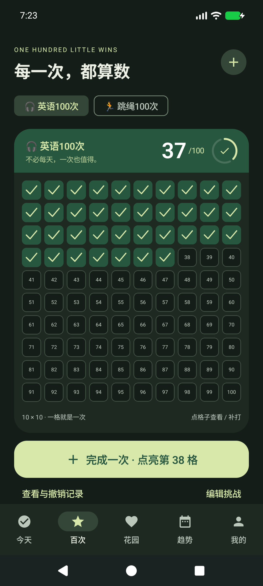

# 青芽 · Qingya

**每一次，都算数。** 一款中文、离线优先的 Android 习惯与百次挑战应用。以 Kotlin / Jetpack Compose 原生实现，无账号、广告或分析 SDK。

[下载最新 APK](https://github.com/ForXd/tree-growh/releases/latest) · [竞品调研](docs/research.md) · [产品设计](docs/design.md) · [发布与更新](docs/releasing.md) · [验证记录](docs/verification.md)

## 界面

<p> </p>

截图仅为测试示例数据，首次安装的花园为空。

## 百次挑战

自定义「英语」「跳绳」「运动」「练琴」等项目，每个项目都有独立 **10×10 的 100 格成就卡**。不要求每天完成，没有连续天数或截止日期。同一天可记录多次。

- 大按钮一键点亮下一个空格，也可以点任意格子补打。
- 每格独立保存完成时间和可选备注，例如「跳绳 500 下」「听力 20 分钟」。
- 点击已完成格子查看或修改备注；撤销前确认，不影响其他格子。
- 勾号描边、填色、进度数字与阶段庆祝；100 次完成后保留完整卡片。
- 多个自定义项目、重命名/换图标、收藏与重新开启；都包含在备份中。

## 日常习惯

- 创建、编辑、按星期重复、量化目标与单位、归档。
- 今日快捷完成、撤销、数量增减、备注；月历选择过去日期补记。
- 目标和星期计划按生效日期保存，修改不会重算过去的目标。
- 今天、百次、花园、趋势、我的五个入口；累计成长、周趋势、月历完成率。
- 每日一个温柔提醒，只在当天还有未完成习惯时发送。百次挑战不按天催促。
- 浅色/深色/跟随系统、减少动画；有限动效，不持续运行动画循环。

花园新叶 = 完成目标的「习惯+日期」记录数 + 百次挑战已完成格数。撤销会修正累计值；归档/收藏保留历史；漏做不让树枯萎。每 30 片叶子为一季。

## 安装与自动更新

支持 Android 8.0 / API 26 及以上，通用 APK，无原生 ABI 限制。仅通过本仓库 GitHub Releases 分发，尚未上架 Google Play。

应用前台每天自动检查一次新版本；「我的 → 应用更新」可立即手动检查。用户点击下载后，在应用内显示进度，并验证 SHA-256、APK 包名、版本号和签名，再交给 Android 系统确认覆盖安装。首次需要允许青芽安装应用。**不会静默安装。更新时不要先卸载。**

下载关闭面板后可继续；进程被系统结束后需要重试，已完成文件可在重新检查并点击下载时重新校验复用。网络不可用时不影响离线打卡。自动更新依赖设备能访问 GitHub；无法访问时可另行下载同签名 APK 覆盖安装。

## 数据与隐私

数据保存在应用私有目录，使用原子文件写入；无账号、云同步、社交和遥测。除更新检查/下载访问 GitHub 外，不主动联网。系统自动云备份和设备迁移已显式禁用，请使用应用内 JSON 导出/恢复。

恢复会校验格式、版本、ID、日期、重复格和数值边界，确认后整体替换；不接受损坏数据。备份是明文，包含备注，请妥善保管。卸载会删除本地数据。详情见 [隐私说明](docs/privacy.md)。

## 构建

需要 JDK 21、Android SDK Platform `37.0`、Build Tools `37.0.0`。设置 `JAVA_HOME`、`ANDROID_HOME` 后：

```sh
./gradlew testDebugUnitTest lintRelease assembleDebug assembleDebugAndroidTest assembleRelease
```

- Debug 包名：`com.forxd.treegrowth.debug`，与正式版隔离。
- 正式包名：`com.forxd.treegrowth`。Release 构建启用 R8，默认未签名。
- `scripts/env.sh` 会优先尊重已有环境，也支持当前机器上的 Pocket Live 工具链。
- `scripts/release.sh` 生成签名 APK、`SHA256SUMS`、`update.json`；签名材料绝不入库。
- GitHub Actions 对主分支运行单元测试、Lint 和 Release 构建；手动触发发布工作流可签名上传新版。

设备测试：

```sh
adb install -r app/build/outputs/apk/debug/app-debug.apk
adb install -r app/build/outputs/apk/androidTest/debug/app-debug-androidTest.apk
adb shell am instrument -w -e class com.forxd.treegrowth.GardenDeviceTest \
  com.forxd.treegrowth.debug.test/androidx.test.runner.AndroidJUnitRunner
```

设备测试只修改 debug 包内数据。截图测试需额外传入 `-e screenshots true`，仅测试设备会生成示例记录；正式安装没有预置成绩。

## 项目结构

- `GardenData.kt`：日期计划、习惯记录、统计、备份验证、原子持久化。
- `Challenge.kt`：100 格领域模型与幂等记录/撤销。
- `ChallengeScreen.kt`：挑战卡、10×10 网格、记录面板和有限庆祝动效。
- `MainActivity.kt`、`HabitEditor.kt`、`Theme.kt`、`SettingsScreen.kt`：原生界面。
- `Reminders.kt`：日提醒与重启/时区变化后的重排。
- `AppUpdater.kt`：固定发布源、流式下载、校验与系统安装交接。

调研参考九款产品，更新架构参考本地 Pocket Live 的行为与验收经验；应用业务、UI 和更新器为独立实现，没有复制竞品图形资产或 Pocket Live 的 AGPL 源码。Gradle Wrapper 保持上游许可声明。第三方依赖见 [THIRD_PARTY_NOTICES.md](THIRD_PARTY_NOTICES.md)。
